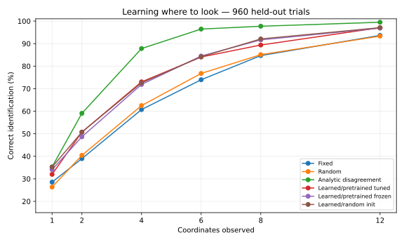

# One Tiny Transformer

**A real trained transformer small enough to open and inspect in a browser.**

[Open the interactive demo](https://anttiluode.github.io/OneTinyTransformer/) · [Explore the source](index.html)



## What is this?

`index.html` is an offline, single-file language-model lab. It contains its own **trained** weights and JavaScript inference engine: **24 residual features, 4 transformer blocks, 2 attention heads, RoPE, a 70-token word vocabulary and a 24-token context**. It demonstrates the residual stream, attention weights, and generated text. Its tiny story world is intentionally narrow; it is not a general language model.

The experiments ask a different question inspired by the project's history with [GeometricNeuronOriginReview](https://github.com/anttiluode/GeometricNeuronOriginReview) and [SihtiImageModel](https://github.com/anttiluode/SihtiImageModel):

> If all learned weights stay fixed, can an internal query explore the structure of the model without being given a new text prompt? And if the system can choose its next observation, can it **learn to look where the information is**?

## What the experiments actually show

**1. Promptless recurrence** (`experiments/promptless_explorer.py`): the pretrained model's weights are held fixed and a new explicit recurrent latent-state rule is added. Some query policies form exact short cycles. This is *not* an ability of the original autoregressive model, and a recurring loop alone is not intelligence. A separate active-sensing control showed why a statistical disagreement rule is useful; random vectors worked too.

**2. Learned observation selection** (`experiments/learned_query_policy.py`): a small **trainable coordinate-query transformer** reuses the original model's Q/K/V, output and MLP matrices as its initialization. It receives eight candidate 24-dimensional patterns and partial noisy observations, chooses one unseen coordinate to reveal next, and learns from simulated feedback about the hidden target. The same Gaussian decoder is used with every policy. This is a new **bidirectional** 24-coordinate model, not ordinary free-running text generation.

After **four measurements**, on **960 held-out trials** with eight candidates per trial and noise standard deviation **0.9**:

| Method | Accuracy |
|---|---:|
| Fixed coordinate order | 60.7% |
| Random coordinates | 62.5% |
| Learned, original blocks fine-tuned | **73.0%** |
| Learned, original blocks frozen | 71.9% |
| Learned, randomly initialized blocks | 72.6% |
| Analytic posterior-weighted disagreement | **87.8%** |

The train/test sets use **disjoint word embeddings** (45 words for training, 24 held out). Results are one reproducible seed/configuration, not a multiple-seed performance distribution or a statistical demonstration that pretrained weights help. See [the full learned-policy receipt](experiments/LEARNED_POLICY.md) and [machine-readable results](experiments/results_learned_policy.json).

**What survived:** a transformer can learn a useful active-observation policy from environment outcomes, rather than being handed the disagreement score. **What did not survive:** on this test there is no convincing advantage from the original LM weights; all learned policies trail the well-matched analytic rule. This is a small synthetic information-acquisition task, not open-ended curiosity or autonomous reasoning.

## Run locally

Open `index.html` in a browser. No installation, server, download or GPU is required for the demo.

For the earlier frozen-weight experiment:

```bash
pip install numpy
python experiments/promptless_explorer.py
```

For the learned-policy experiment (CPU; roughly a minute on the reference runner, machine-dependent):

```bash
pip install numpy torch
python experiments/learned_query_policy.py --steps 300 --trials 960
python -m unittest discover -s experiments -t . -v
```

It reads the **actual trained weights from `index.html`**. It writes `experiments/results_learned_policy.json` and a local `experiments/learned_policy.pt`. The checkpoint is not committed: rerun the seeded experiment to recreate it. If you change `index.html`'s embedded weights, rerun the experiment before comparing results.

## Files

- [`index.html`](index.html) — original interactive trained transformer; preserved unchanged
- [`experiments/promptless_explorer.py`](experiments/promptless_explorer.py) — frozen-state autonomous queries and statistical sensing baseline
- [`experiments/RESULTS.md`](experiments/RESULTS.md) — original autonomous-recurrence experiment receipt
- [`experiments/learned_query_policy.py`](experiments/learned_query_policy.py) — learning to select the next coordinate using new feedback
- [`experiments/LEARNED_POLICY.md`](experiments/LEARNED_POLICY.md) — protocol, observed results and limitations
- [`experiments/results_learned_policy.json`](experiments/results_learned_policy.json) — full numeric results
- [`experiments/test_learned_query_policy.py`](experiments/test_learned_query_policy.py) — quick regression checks

## Interpretation

A trained matrix is fixed during ordinary inference, but **a query state can move through a landscape defined by those weights**. A different question is how a model chooses where to look next. In this repository the second part is an explicit learned policy, with a hidden synthetic target and limited observation budget. It makes no claim about biology, consciousness, independent discovery, or whether transformer attention distributions are calibrated probabilities.

Experiment code and weights are offered as inspectable, falsifiable research toys, including results where an ordinary method wins.